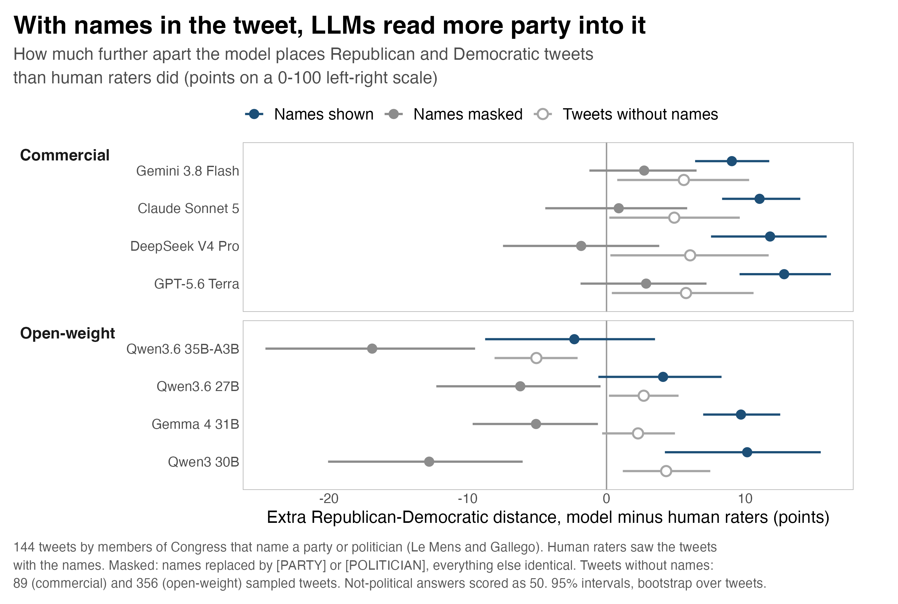
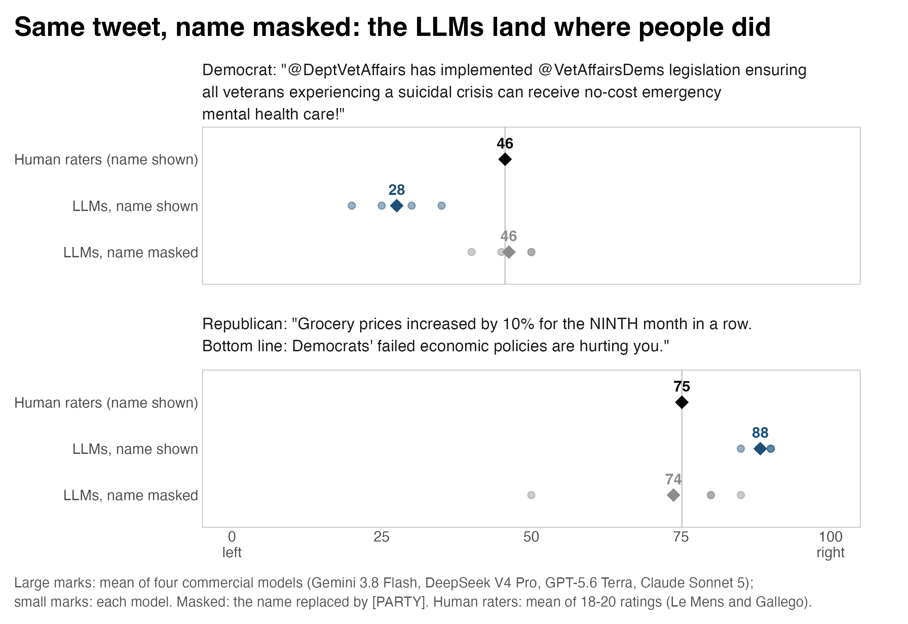
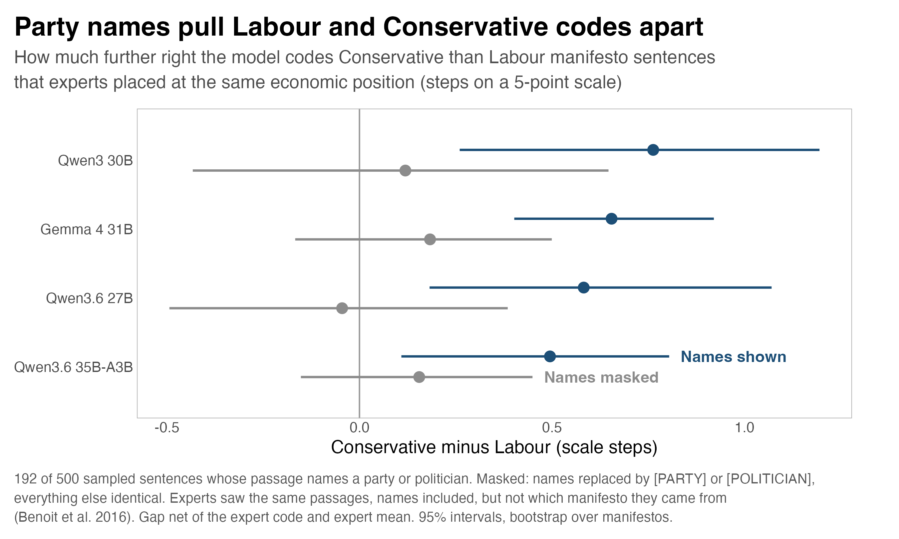

# Party names in the text and LLM position coding

Quick experiment, October 2026. Does it matter for LLM-based scaling if the text names a party or a politician?

Short answer: for tweets, yes.

- Data: congressional tweets with 0 (left) to 100 (right) ratings from people, collected by Le Mens and Gallego (2025). 500 of them, scored by eight LLMs.
- 144 of the 500 name a party or politician. On those, the four commercial models spread Republicans and Democrats 9–13 points further apart than the people did.
- Swap the names for `[PARTY]` / `[POLITICIAN]` and rerun: most of that excess goes away.
- Tweets without names were run twice as well. They hardly move. Not noise, then.
- UK manifestos (expert codes, Benoit et al. 2016): same for the open-weight models, weaker for the commercial ones.

For anyone placing statements (not speakers) with LLMs: try masking names and see whether your numbers move. Caveat, names are sometimes content. "Biden's inflation" reads right-wing partly because of the name. On named tweets masking costs 1–4 points of accuracy against the human ratings.

One run per model, two corpora. First look, not a paper.

## Results

### Tweets



Plotted per model: Republican minus Democratic, in (model score − mean human rating). Positive = model pulls the parties further apart than people did.

| | as written | masked |
|---|---|---|
| commercial, named tweets | +9.0 to +12.8 | −1.8 to +2.9 (CIs include 0) |
| commercial, tweets w/o names | about +5 | about +5 |
| Gemma 4 31B, Qwen3 30B | about +10 | −5 to −13 |
| Qwen3.6 27B, Qwen3.6 35B-A3B | +4, −2 | −6, −17 |

Reading this: there's over-separation even without names; names about double it. Open-weight models are mixed, and after masking they all land below the human gap (my guess: masking removes stuff raters used).

NA check. Models can say "NA" (not political); I code it as 50. Masking makes NA more frequent (Gemma 4 on named tweets: 3% → 18%), which shrinks the gap mechanically. Dropping tweets with NA in either run, commercial models: +9.6 to +17.0 named, +1.1 to +8.3 masked. GPT-5.6 Terra keeps 8.3 (4.2–12.3). So: most of the gap, not all of it.

Two examples. A Democrat's tweet about "@VetAffairsDems legislation" on emergency mental health care for veterans: raters 46, commercial models 28 on average, 46 with the handle masked. A Republican's tweet blaming "Democrats' failed economic policies" for grocery prices: 75 / 88 / 74.



### Manifestos



Sentences whose passage names a party or politician only, same expert code:

- open-weight models put Tory sentences 0.50–0.76 steps (5-point economic scale) right of Labour ones; masked, −0.05 to 0.18 (CIs include 0)
- commercial models: same sign, 0.06–0.20
- but the commercial ones do it with no names in the passage too (Claude Sonnet 5: 0.74 steps). For them it's mostly not names, which is why the figure is open-weight only

Everything, social scale included: [`results/benoit_masking.csv`](results/benoit_masking.csv).

## Design

- Tweets: 899 congressional tweets, ~16 ratings each (Le Mens and Gallego 2025). Raters saw names in the text, not the author. Seeded sample of 500.
- Manifestos: 18 Con/Lab/LD manifestos, 1987–2010; 3–7 expert coders per sentence, 5-point economic and social scales (Benoit et al. 2016). Benchmark = modal code, ties dropped. 500 sentences per scale, with up to two sentences of context.
- Masking: [`code/01_mask_names.py`](code/01_mask_names.py), regexes. Parties → `[PARTY]`, politicians (names, handles, hashtags like #BidenFlation) → `[POLITICIAN]`. Lower-case "conservative values" etc. stays. No name = identical text = placebo.
- Open-weight models: Gemma 4 31B, Qwen3.6 27B, Qwen3.6 35B-A3B, Qwen3 30B-A3B. vLLM, via [polsci-open-bench](https://github.com/hhilbig/polsci-open-bench), all 500 items.
- Commercial: Gemini 3.8 Flash, DeepSeek V4 Pro, GPT-5.6 Terra, Claude Sonnet 5 (OpenRouter). All named items + random 25% of the others. Cost ~$7.
- Prompts in [`prompts/`](prompts/), identical across models, JSON out. Temp 0 for open-weight + DeepSeek, default for the rest; reasoning off/minimal.
- 95% CIs: 2,000 bootstrap draws (tweets resampled, or whole manifestos).

Limits:

- one run per model
- humans and experts saw the names too. So: LLM vs. a person reading the same text, not vs. a name-free truth
- the regexes were written for these two corpora and surely miss a few names (bias toward 0, if anything)

## Related work

Closest: Vallejo Vera and Driggers (2025, *Humanities and Social Sciences Communications*; [arXiv](https://arxiv.org/abs/2408.15895)). Party labels added to Austrian immigration statements; LLM annotators shifted more than human coders. Fits with this. Differences here: names already in the texts, continuous scale, masking + placebo, human/expert codes of the same texts.

Humans respond to party cues too (Benoit et al. 2016; Ennser-Jedenastik and Meyer 2018). Masking or replacing names before LLM annotation has been suggested before (Walker and Angst 2025; Elbouanani et al. 2025). Jeoung et al. (2025) find LLMs exaggerate party positions relative to survey respondents.

## Reproducing

```bash
python3 code/01_mask_names.py --check   # rebuilds the masked files and compares
python3 code/02_analyze.py              # estimates -> results/ (a few minutes)
Rscript code/03_figures.R               # -> figures/
```

`predictions/` has every model answer (group, model, `orig`/`masked`, item, prediction, raw output). [`code/00_export_predictions.py`](code/00_export_predictions.py) pulled them out of the benchmark runs. [`code/run_commercial_models.py`](code/run_commercial_models.py) is what ran the commercial models; it only works inside polsci-open-bench. Needs pandas and numpy; for the figures, dplyr, ggplot2, readr and scales.

## Data

- Le Mens, Gaël, and Aina Gallego. 2025. "Positioning Political Texts with Large Language Models by Asking and Averaging." *Political Analysis* 33: 274–282.
- Benoit, Kenneth, Drew Conway, Benjamin E. Lauderdale, Michael Laver, and Slava Mikhaylov. 2016. "Crowd-Sourced Text Analysis: Reproducible and Agile Production of Political Data." *American Political Science Review* 110(2): 278–295.
