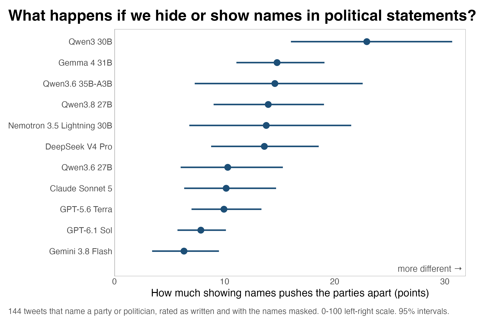
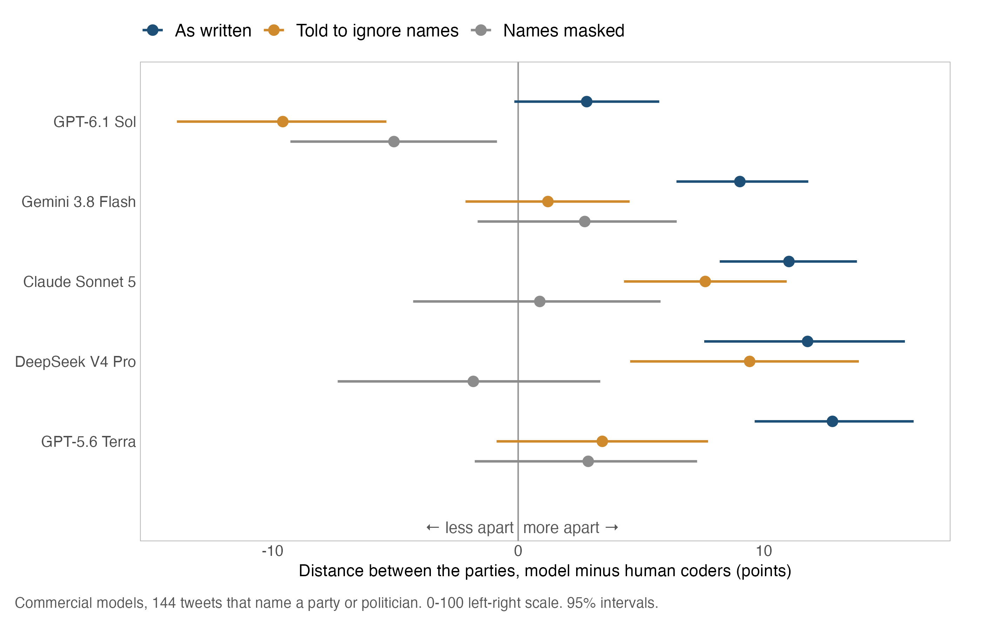
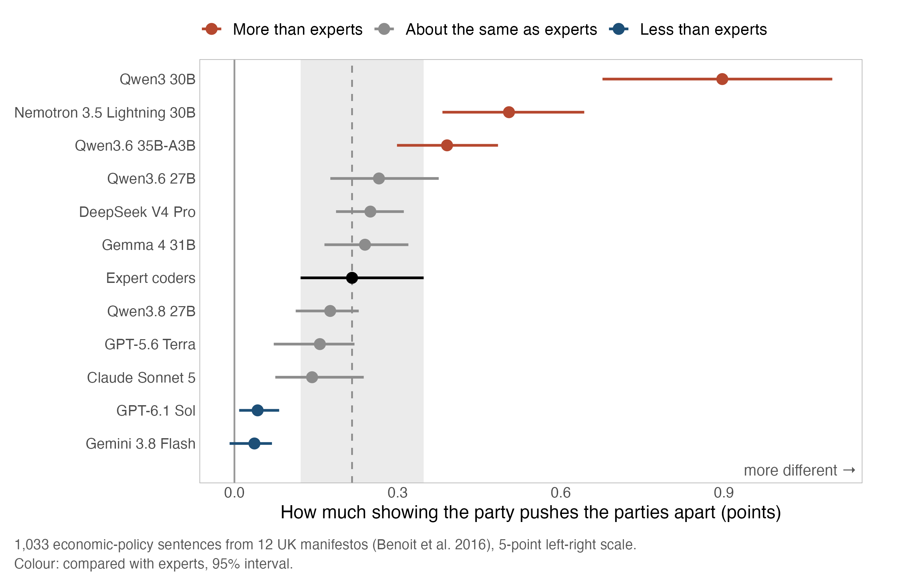

# Party names in the text and AI ratings of political statements

Quick experiment, October 2026. How AI models classify political statements as left- or right-leaning depends a lot on whether the statement names a party.

For example, a Republican tweet blames "Democrats' failed economic policies." Human coders rated it, on average, 75 on a scale from 0 to 100, where 100 is most right-wing. AI models rated it 88. If we give the same tweet to the same models but replace "Democrats" with `[PARTY]`, they rate it almost exactly where human coders put it (74).


## Names in tweets

I asked 11 AI models to rate tweets by members of Congress that human coders had already rated (Le Mens and Gallego 2025). Tweets that name a party or politician (144 of 500) were rated twice: once as written, and once with the names masked as `[PARTY]` or `[POLITICIAN]`.

For some models, the names make Republican and Democratic tweets look much further apart on the left-right scale. For others, the names push them apart much less.



Numbers: 6 points (Gemini 3.8 Flash) to 23 points (Qwen3 30B). Placebo (tweets without names, also rated twice): under 2 points for every model.

How does this compare to human coders who also saw the names? With names, six of the eleven models put Republicans' and Democrats' tweets further apart than human coders did. With names masked, that extra distance disappears, and some models put them closer together than human coders did.

However, this doesn't necessarily mean the masked version is right. Without names, every model's ratings of individual tweets agree less with human coders, who saw the names. Masking clearly changes what the models do, but it's not obvious to me whether masked or unmasked ratings are more desirable.


Numbers: with names, the six models are 9 to 13 points above the human coders. Masked: commercial models −2 to +3 (GPT-6.1 Sol −5), open-weight models −5 to −24. Mean absolute error vs. human coders, masked minus as written: +1.1 to +5.3.

## Telling the model to ignore names

Vallejo Vera and Driggers (2025) found that adding party labels to statements changed AI ratings. They also found that telling the model to ignore the labels doesn't fix the shift. I tried the same with names in tweets.

For some models, like GPT-5.6 and Gemini, telling models to simply ignore names removed most of the extra distance, as masking did. Others, like Claude and DeepSeek, barely reacted to this additional instruction. GPT-6.1 Sol went past zero. Instructions such as "ignore the names" work for some models and not others, so they are not a reliable fix.



## Do people react to party labels too?

The clear next question is whether showing or hiding party labels makes as much of a difference to AI models as to humans. The tweet coders always saw the names, so I used a 2016 study by Benoit and colleagues in which experts rated UK manifesto sentences twice: first with the party's manifesto title shown and later without it. I did the same with the models (1,033 economic-policy sentences from 12 manifestos). Knowing the party moved six of the eleven models about as much as the experts. Two, GPT-6.1 Sol and Gemini, barely responded, and the rest responded more (Qwen3 30B about four times as much).

If we take changed ratings due to showing or hiding party labels as a natural part of how humans perceive political statements, some AI models show somewhat similar behavior. However, AI models vary much more in how strongly they respond: from barely at all to several times as much as the experts.

One caveat: the expert comparison is not randomized. Experts saw the title first and coded again without it about a year later, so their difference also contains order and time.



## Should we mask names?

Using AI to read political texts raises an interesting question: should the model use the names or not? The names carry information that people themselves use when rating these statements, and the same statement by a Republican or a Democratic politician may convey a different meaning.

Others have recommended masking names (Walker and Angst 2025; Elbouanani et al. 2025). However, humans respond to party labels too.

Whether to mask names depends on how much researchers think the speaker changes the meaning of a statement. For researchers who study how people perceive or respond to political statements, for example as a treatment in studies of attitudes or behavior, keeping the names seems the better choice, since people see who is speaking. If researchers want to measure only what the text says, masking seems the better choice.

In any event, it makes sense to run at least a robustness check in which a subset of statements is coded with names hidden, so the reader can see how much of a difference this makes for the analysis.

One run per model. First look, not a paper.

## Design

- Tweets: 500 of the 899 in Le Mens and Gallego (2025), about 16 human ratings each. Commercial models rated the 144 named tweets plus 89 others.
- Manifestos: Conservative, Labour and Liberal Democrat manifestos, 1987–2010, expert codes from Benoit et al. (2016).
- Commercial models: Gemini 3.8 Flash, DeepSeek V4 Pro, GPT-5.6 Terra, Claude Sonnet 5, GPT-6.1 Sol (OpenRouter).
- Open-weight models: Gemma 4 31B, Qwen3.6 27B, Qwen3.6 35B-A3B, Qwen3 30B-A3B, Qwen3.8 27B, Nemotron 3.5 Lightning 30B (vLLM, via [polsci-open-bench](https://github.com/hhilbig/polsci-open-bench)).
- Masking by regex: [`code/01_mask_names.py`](code/01_mask_names.py). Prompts in [`prompts/`](prompts/).
- Ignore instruction, appended to the prompt: "The text may name political parties or politicians. Judge only the position the text itself expresses. Do not let the names, or anything you know about those parties or people, affect your answer."
- 95% intervals: 2,000 bootstrap draws.
- [`results/`](results/): all estimates. Also masking in manifesto sentences (figure 3), and the tweet results without "not political" answers.

## Reproducing

```bash
python3 code/01_mask_names.py --check   # rebuilds the masked files and compares
python3 code/02_analyze.py              # estimates -> results/
Rscript code/03_figures.R               # -> figures/
```

`predictions/` has every model answer. [`code/run_commercial_models.py`](code/run_commercial_models.py) ran the commercial models; it only works inside polsci-open-bench.

## Data

- Le Mens, Gaël, and Aina Gallego. 2025. "Positioning Political Texts with Large Language Models by Asking and Averaging." *Political Analysis* 33: 274–282.
- Benoit, Kenneth, Drew Conway, Benjamin E. Lauderdale, Michael Laver, and Slava Mikhaylov. 2016. "Crowd-Sourced Text Analysis: Reproducible and Agile Production of Political Data." *American Political Science Review* 110(2): 278–295.
